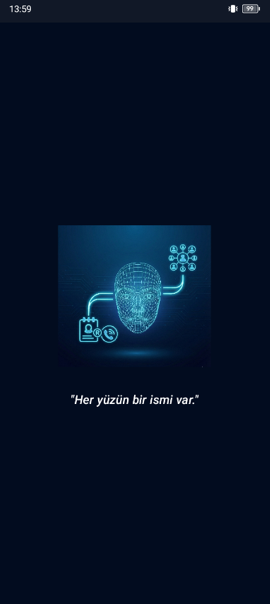
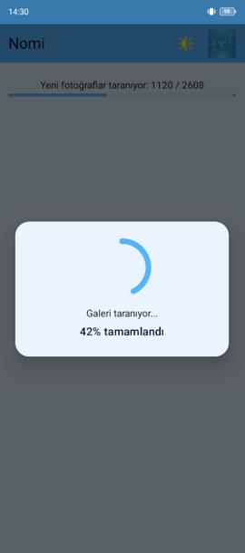
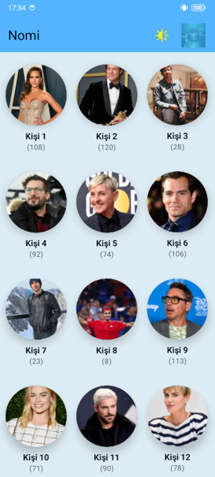
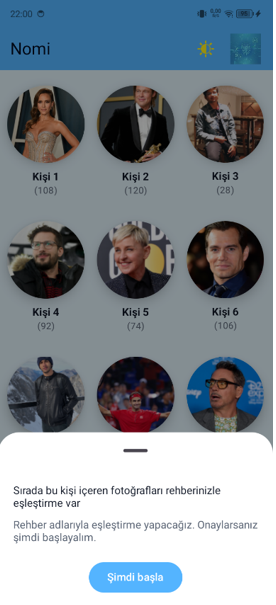
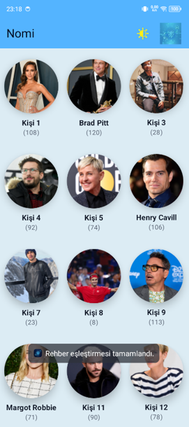
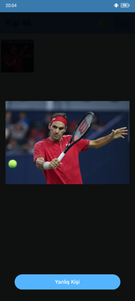
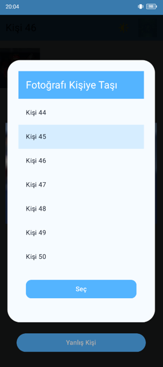

> 🇹🇷 Nomi, mobil cihaz galerisindeki fotoğrafları cihaz üzerinde analiz ederek aynı kişiye ait yüzleri otomatik olarak gruplayan, yapay zekâ destekli akıllı galeri uygulamasıdır. Projede MediaPipe, EdgeFace, ONNX Runtime, Room/SQLite ve DBSCAN kullanılmıştır.

# Nomi - AI-Powered Smart Gallery Mobile Application

Nomi is an AI-powered Android mobile application developed to organize personal photo galleries by automatically detecting, analyzing and grouping faces that belong to the same person.

The application focuses on privacy-oriented on-device processing. Instead of sending personal photos to external servers, Nomi processes gallery images locally on the mobile device and creates person-based photo clusters.

## Project Overview

With the increasing number of photos stored on smartphones, finding images of a specific person becomes difficult over time. Traditional gallery organization methods such as date, folder or album-based sorting are often not enough for person-focused access.

Nomi addresses this problem by scanning gallery photos, detecting faces, extracting face embeddings and grouping similar faces under person clusters. Users can also rename detected people, correct incorrect assignments and optionally match person clusters with contacts on the device.

## Key Features

- Gallery photo scanning
- Face detection using MediaPipe FaceDetector
- Face alignment with facial landmark points
- Face embedding extraction using EdgeFace
- ONNX Runtime integration for on-device AI inference
- Person-based photo clustering
- Cosine similarity-based face comparison
- DBSCAN-based cluster merging
- Contact matching support
- Person name editing
- Incorrect person assignment correction
- Light and dark theme support
- Privacy-focused local processing

## Technologies Used

- Kotlin
- Android
- Jetpack Compose
- XML Layout
- Room / SQLite
- MediaPipe
- ONNX Runtime
- EdgeFace
- DBSCAN
- Cosine Similarity
- MV-like layered architecture
- Repository, DAO and Use Case structures

## AI Pipeline

The artificial intelligence pipeline of Nomi consists of the following steps:

1. Scanning gallery photos from the device
2. Detecting faces in each photo
3. Aligning detected faces using landmark points
4. Extracting numerical face embeddings
5. Comparing embeddings using cosine similarity
6. Creating person clusters
7. Merging similar clusters with DBSCAN
8. Displaying grouped photos in a person-based gallery interface

## Architecture

Nomi was designed with a modular structure to separate user interface, data management and AI processing responsibilities.

Main architectural components include:

- Presentation layer for UI and user interactions
- Repository layer for data access abstraction
- Room database for local data storage
- DAO structures for database operations
- Use Case classes for business logic
- AI processing components for face detection, alignment and embedding extraction

## Database Structure

The local database stores face, person and scan-related information on the device.

Main entities include:

- `Persons`: Stores person clusters and centroid embeddings
- `Faces`: Stores detected face records and embedding vectors
- `PhotoScan`: Tracks scanned photos to avoid unnecessary reprocessing
- `FaceHistory`: Stores face reassignment history for user corrections

## Experimental Results

During the experimental evaluation:

- MediaPipe FaceDetector achieved approximately **98.66% face detection accuracy**
- EdgeFace achieved approximately **98.10% performance** in face representation and clustering evaluation

These results showed that the selected AI pipeline is suitable for mobile and privacy-focused gallery organization scenarios.

## Privacy-Oriented Design

Nomi is designed to process personal photos directly on the device. This approach helps reduce the need to transfer sensitive photo or face data to external servers.

The application follows a privacy-focused structure by keeping gallery scanning, face detection, embedding extraction and clustering operations local whenever possible.

## Screenshots

| Splash Screen | Gallery Scan | Person Clusters |
|---|---|---|
|  |  |  |

| Person Detail | Contact Matching | Contact Matching Result |
|---|---|---|
|  |  |  |

| Correction Flow | Correction Selection | Correction Result |
|---|---|---|
|  |  |  |

## Academic Context

This project was developed as a graduation thesis project in the Department of Computer Engineering at Düzce University.

Thesis title:

**AI-Powered Smart Gallery Mobile Application: Nomi**

## Contributors

This project was developed by:

- [Nursena Duyku](https://github.com/nursena-pc)
- [İrem Nur Şahin](https://github.com/Iremnursh)

## Project Status

Developed between 2025 and 2026.

The project is currently maintained as an academic graduation thesis project and portfolio work.

## License

This project is shared for academic and portfolio purposes.
